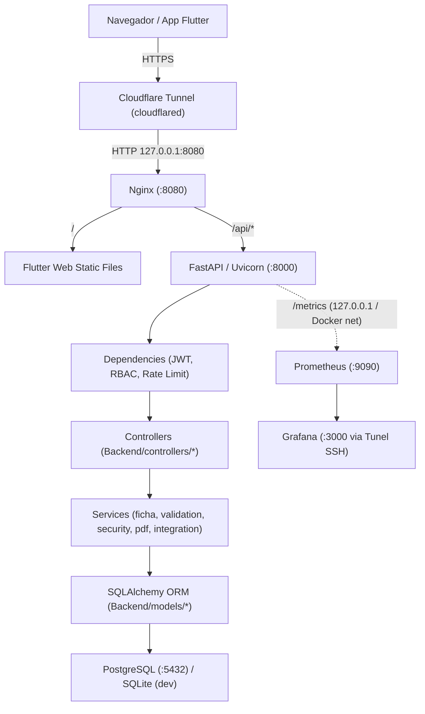

# Arquitetura e Decisões Técnicas

## Fluxo Completo de uma Requisição

O sistema opera em produção dentro de uma instância AWS EC2 (`sa-east-1`) utilizando **Docker Compose**, com exposição pública segura via **Cloudflare Tunnel** (sem abrir portas HTTP/HTTPS no firewall da AWS).

### Caminho passo a passo
1. O usuário interage com a interface Flutter (`Frontend/lib/views/`), que envia requisições via `ApiClient` (`Dio`) com o token JWT no header `Authorization: Bearer <token>`.
2. O **Cloudflare Tunnel** encaminha o tráfego HTTPS para o **Nginx (`:8080`)**, que serve o frontend estático e faz proxy reverso de `/api/` para o **FastAPI (`:8000`)**.
3. `Backend/dependencies.py` (`get_usuario_atual`) valida o JWT, verifica revogação (`TokenRevogado`), `token_version` e status do usuário.
4. Os **Controllers** validam os schemas **Pydantic** (`Backend/schemas.py`) e delegam às camadas **Services** (`ficha_service.py`, `validation_service.py`), que persistem via **SQLAlchemy** no **PostgreSQL** e registram auditoria (`LogAuditoria`).

---

## Pontos de Entrada da Aplicação

### Back-end (`Backend/main.py`)
* Gerencia o ciclo de vida (`lifespan`) executando `init_db()` na inicialização:
  * Cria tabelas ausentes (`Base.metadata.create_all`).
  * Executa `ajustar_colunas_novas()` para evoluções incrementais de schema sem perda de dados.
  * Executa `seed_initial_data()` **somente quando `APP_ENV == "development"`**.
* Desabilita `/docs`, `/redoc` e `/openapi.json` quando `APP_ENV == "production"`.
* Registra `CORSMiddleware`, `slowapi` (rate limiting), `api_router` (`/api`) e o instrumentador Prometheus (`/metrics`) com `_patch_prometheus_included_router()` para compatibilidade com FastAPI `>= 0.137`.

### Front-end (`Frontend/lib/main.dart`)
* `main()` inicializa os bindings do Flutter e restaura sessão prévia via `AuthService().restaurarSessao()`.
* Configura `MultiProvider` (`AdminDataService`, `DashboardProvider`, `FichaEmAndamentoProvider`, `AuthService`, `DatabaseService`, `SyncService`, `GpsService`).
* Usa `onGenerateRoute` como guarda central de autenticação e autorização por perfil (`PerfilUsuario.admin` vs equipe assistencial).

---

## Decisões de Stack e Alternativas Descartadas

| Escolha | Motivo | Alternativa Descartada |
| :--- | :--- | :--- |
| **Flutter (Web + Mobile)** | Base única de código para painel web administrativo e aplicativo móvel/tablet offline-first. | React/Next.js + app nativo separado (duplicaria manutenção). |
| **FastAPI (Python 3.13)** | Tipagem forte com Pydantic, alta performance, `BackgroundTasks` nativo e ecossistema Python para PDF (`ReportLab`). | Django (mais acoplado/pesado) ou Express.js (sem validação tipada nativa). |
| **PostgreSQL + SQLite fallback** | Integridade ACID e segurança relacional em produção; SQLite em dev para setup imediato sem dependências externas. | MongoDB / NoSQL (relacionamentos rígidos de prontuários e auditoria favorecem SQL). |
| **Cloudflare Tunnel** | Publicação HTTPS sem expor portas 80/443 na EC2 e com proteção DDoS na borda. | Certbot direto com portas abertas no Security Group. |
