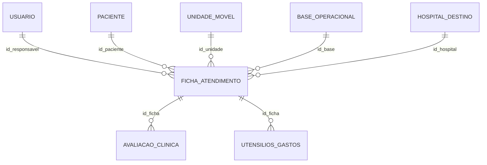

# Modelo de Dados, Regras Clínicas e API

## Entidades Principais (`Backend/models/`)

* **`Usuario` (`usuario`):** autenticação, perfil RBAC (`ADMINISTRADOR`, `ENFERMEIRO`, `TECNICO`, `CONDUTOR`), `ativo`, `trocar_senha` e `token_version`.
* **`Paciente` (`paciente`):** dados demográficos, alergias, histórico clínico e `documento` (CPF pseudonimizado em HMAC-SHA256).
* **`FichaAtendimento` (`ficha_atendimento`):** registro central da ocorrência, `uuid_offline` (idempotência), equipe (`Medico`, `Tecnico`, `Condutor`), geolocalização, horários do atendimento e status de envio à Prefeitura.
* **`AvaliacaoClinica` (`avaliacao_clinica`):** sinais vitais (PA, FC, FR, SpO2, glicemia, temperatura), Escala de Glasgow, triagem de AVC e conduta.
* **`Utensilios` (`utensilios_gastos`):** controle de medicamentos/materiais gastos e status de reposição (`reposto`).
* **`LogAuditoria` (`log_auditoria`) & `TokenRevogado` (`token_revogado`):** trilha de auditoria LGPD e blocklist de logout.

---

## Evolução de Schema (Migrations)
* **Alembic:** a migration inicial versionada encontra-se em `Backend/alembic/versions/3dfe68d990ee_initial_schema_migration.py`.
* **Evolução incremental automática:** a função `ajustar_colunas_novas()` em `Backend/main.py` inspeciona as tabelas existentes na inicialização e aplica `ALTER TABLE ... ADD COLUMN` com segurança para novas colunas adicionadas ao modelo sem perder dados.

---

## Regras de Negócio Clínicas (`Backend/services/validation_service.py`)

Antes de persistir uma ficha em `criar_ficha_completa()` (`Backend/services/ficha_service.py`), `validar_regras_clinicas_ficha()` verifica:
1. Obrigatoriedade de **Unidade Móvel (`id_unidade`)** e **Médico de plantão (`id_medico`)**.
2. Formato de **Pressão Arterial** (`^\d{2,3}\s*[/xX]\s*\d{2,3}$`, ex.: `120/80`).
3. Faixas fisiológicas válidas:
   * Frequência cardíaca: `20` a `250` bpm
   * Frequência respiratória: `5` a `60` rpm
   * Temperatura: `25.0` a `45.0` °C
   * Glicemia / Hemoglicoteste: `10` a `800` mg/dL
   * Saturação O2: `40%` a `100%`
   * Escala de Glasgow: `3` a `15` e consistência matemática (`abertura_ocular + resposta_verbal + resposta_motora == escala_glasgow`)
4. Ordem cronológica dos horários (`hora_chamado` → `hora_saida_base` → `hora_chegada_local` → `hora_saida_local` → `hora_chegada_hospital` / `hora_conclusao`).
5. Validação matemática de CPF (`validar_formato_cpf`) e obrigatoriedade de motivo caso `unidade_parada=True`.

---

## Principais Rotas da API (`/api`)

| Prefixo | Arquivo Controller | Responsabilidade |
| :--- | :--- | :--- |
| `/api/auth` | `auth_controller.py` | Login JWT, logout (revogação `jti`), troca de senha obrigatória |
| `/api/fichas` | `ficha_controller.py` | Criação, listagem paginada, detalhes, PDF, reposição e reenvio à Prefeitura |
| `/api/sync` | `sync_controller.py` | Sincronização em lote idempotente para atendimentos offline (`uuid_offline`) |
| `/api/cadastros` | `cadastro_controller.py` | Bases, viaturas, hospitais, médicos, técnicos e condutores |
| `/api/usuarios` | `usuario_controller.py` | Gestão de usuários e perfis (restrita a `ADMINISTRADOR`) |
| `/api/ia` | `ollama_controller.py` | Chat assistencial com IA local (Ollama) com whitelist de modelos |
